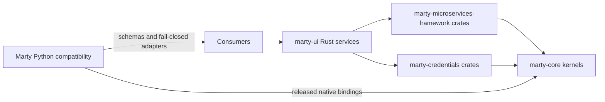

# Marty Compatibility Architecture

> **Current boundary:** this repository is not a deployable Python
> microservice stack. Do not use the historical service ports, YAML service
> names, generated gRPC clients, or modules under `src/` as deployment
> instructions. Runtime services and cryptographic kernels are owned by the
> Rust repositories listed below.

## Repository role

This repository has two supported purposes:

1. publish the independently versioned `marty-common` Python compatibility
   package; and
2. retain language bindings, schemas, and compatibility adapters until a
   consumer audit and language-neutral parity tests prove that they can be
   removed.

The root `marty-identity-compat` project is a packaging and test harness. It has
no supported root service launcher, Python plugin entry point, container image,
Helm chart, or Kubernetes deployment.

## Canonical Rust ownership

| Capability | Canonical owner | Current implementation boundary |
| --- | --- | --- |
| CSCA certificate creation algorithms and eMRTD trust/verification | `marty-core` | Rust certificate, SOD, trust-registry, and verification kernels |
| Passport issuance and document signing | `marty-credentials`, `marty-core` | Rust issuance crates and native Python bindings |
| CSCA key custody, lifecycle metadata, renewal, revocation, filtering, expiry checks, and events | `marty-ui` `signing-keys` | Authenticated Rust service, managed KMS providers, Redis CAS storage, and transactional outbox |
| Trust profiles and registry synchronization | `marty-ui` `trust-profile`, `marty-core` | Rust service and verification kernels |
| Document and presentation verification | `marty-ui` `verification` and `presentation-policy`, `marty-core` | Rust services and native verification bindings |
| Reusable service runtime, policy, storage, telemetry, and transport behavior | `marty-microservices-framework` | Shared Rust crates and language-neutral behavior contracts |
| Production deployment composition | `marty-ui` | Versioned Rust service images and deployment manifests |
| Python compatibility package | this repository | Thin native bindings, retained DTOs/schemas, and fail-closed adapters |

## Legacy capability disposition

The old Python Marty platform used service-oriented names that still appear in
schemas, tests, historical policy examples, and generated clients. A name in
this repository does not imply that a server with that name is deployed.

| Historical family | Disposition | What remains here |
| --- | --- | --- |
| `csca_service` | Executable Python service retired after Rust parity gates | Generated protobuf compatibility types only; certificate lifecycle behavior is Rust-owned |
| `document_signer` | Executable Python service retired | Generated client types and adapters that delegate canonical signing input; no local signing fallback |
| `passport_engine` | Executable Python service retired | Generated protobuf compatibility types; issuance and verification kernels are Rust-owned |
| `inspection_system` | Executable Python service retired | Generated protobuf compatibility types; verification kernels are Rust-owned |
| `dtc_engine` | Compatibility adapter retained pending consumer removal proof | Python orchestration delegates DTC canonicalization, assembly, and verification to Rust and fails closed |
| `mdl_engine` / `mdoc_engine` | Compatibility DTO/service adapters retained pending audited replacement | Security-sensitive ISO 18013 behavior is required from the released Rust native backend |
| `document_processing` | Compatibility coordinator retained pending audited replacement | MRZ/verification paths use native kernels; unavailable dependencies and mock backends fail closed |
| `pkd_service` / trust adapters | Compatibility API and data orchestration retained pending audited replacement | ASN.1, CMS, certificate, master-list, CRL, and chain validation are Rust-owned and fail closed without the native backend |
| `src/proto` and `src/marty_plugin/proto` | Retained language bindings | Generated wire schemas for compatibility consumers, not runtime ownership or endpoint availability |

The retained adapters are not permission to reintroduce Python cryptographic
or protocol kernels. They may translate DTOs, coordinate calls, or expose
compatibility interfaces, but synthetic success and silent fallback are
prohibited.

## KMS-only compatibility refactoring

Long-term issuer signing keys belong to the managed KMS boundary of the Rust
`signing-keys` service. Moving a cryptographic primitive into Rust does not
make application-held private PEM, a local key directory, or encrypted private
key database columns into managed custody. Do not add another Python provider
or local fallback as a substitute for the canonical managed signing path.
TLS identities, ephemeral session secrets and product-owned holder/device keys
have separate capability boundaries; do not erase those features as issuer-key
cleanup.

The unconsumed `shared/services/key_management_extended.py` is retired. It
scheduled local-file key rotation, wrote a separate SQLite usage ledger and
computed heuristic security reports. It was not wired into a deployed service
or current tests. Keep the underlying compatibility `KeyManagementService`
until its consumers and native-boundary tests have an actual replacement.
Deleting the extension does not establish KMS-only custody for that base class.

Preserve these lifecycle and coverage requirements under the Rust owner:

- Provider-backed rotation, expiry and activation policy, stable public key
  identity/version metadata, overlap and concurrent-rotation handling.
- Durable tenant-scoped usage/audit records with operation, time and outcome;
  bounded queries, retention and failure behavior. A separate local SQLite
  log must not stand in for the managed service's audit contract.
- Expiry, key-strength and rotation-policy reporting, plus explicitly defined
  anomaly detection. Historical point scores and arbitrary usage thresholds
  did not qualify those security decisions.
- Positive and negative managed-signing/rotation tests, including unavailable
  KMS, wrong tenant/purpose, unsupported algorithms, replay/concurrency and no
  application-held long-term private keys or local fallback. Retained
  authenticated import requirements must terminate at the approved managed-KMS
  boundary; lifecycle APIs must not export private keys.

Rust service tests live with the
[signing-keys owner](https://github.com/ElevenID/marty-ui/tree/main/rust/services/signing-keys/tests).
Their existence is not a claim that provider/device or deployed acceptance is
complete. Pretravel now delegates to the canonical Rust issuance service and
returns a pending wallet offer with `credential: null`; the wallet must complete
proof before Rust assembles and signs the credential through managed KMS.
Python retains evidence verification and request/result translation only.
See [pretravel wallet flow](features/pretravel-wallet-flow.md) for the response
migration, server-bound organization/issuer/template and deployment qualification.

The Rust credential API requires an authorized access token, wallet proof,
one-use nonce, fresh issuer resolution and lifecycle checks before managed
signing. Pretravel must not add an API-key-only signing shortcut. MRZ checksum
consistency does not prove authenticity, liveness or document validity. VDS-NC
trust/signature and NFC/SOD failures remain fail-closed. Unqualified mDoc and
legacy audience/nonce requests are rejected explicitly. The unused Python SD-JWT
issuer and its exports are retired after the pretravel migration; public-JWK
SD-JWT verification remains. The shared bridge now denies private-key operations
and preserves explicit public exports; remaining caller/profile migration work
is recorded in [native KMS compatibility](features/native-kms-compatibility.md).

The unused Python `vc/oidc4vci.py` offer/grant/session dataclasses and their
package exports are retired. No tracked runtime or test consumed them; their
legacy offer encoding is not the current Rust protocol contract. Use the Rust
issuance service for credential offers, authorization, token exchange and
session state. The separate SQLAlchemy `Oidc4VciSessionRecord` and repository
remain pending their own consumer/data audit. The shared Python SD-JWT issuer is retired; downstream imports must move
to Rust initiation and wallet proof.
The root harness no longer installs the unused Authlib or Python `sd-jwt`
engines; retained SD-JWT operations already call Rust native kernels.

## DTC signing custody and migration

The retained DTC compatibility service no longer accepts application-held
signing keys. Nonempty `DTC_SIGNING_KEY_PEM`, `DTC_SIGNING_KEY_PATH`,
`dtc_engine.signing_key_pem` or `dtc_engine.signing_key_path` settings reject at
construction before key-file reads, directory creation or provider connection.
The local `dtc_sign` selection and private-to-public derivation are retired;
existing private-key data are not deleted. Provision signing keys only through
an approved managed KMS owner.

Keep signer identity, public-key PEM/path, trust anchors, certificate chain,
storage/access-key handling and the six lifecycle RPCs. The remote adapter
still uses native `dtc_prepare_signing` canonical bytes and
`dtc_assemble_signature` public-key verification, with no local-key fallback.
Missing providers or invalid returned signatures cannot persist signed state.
The legacy DocumentSigner RPC is a compatibility boundary, not evidence of a
qualified managed-KMS deployment. Its public-key binding alone does not prove
tenant/purpose authorization, provider custody or fresh key lifecycle checks.

Core's DTC create/prepare/assemble/verify kernels do not supply a durable
service implementation of create/get/sign/revoke/QR/verify. The generic Rust
wallet-offer API does not replace that DTC lifecycle. Map its authenticated
access, durable storage, QR payload, revocation/status semantics and managed
signing identity/authorization to the owning Rust service before retiring the
compatibility API or claiming provider acceptance. Preserve Type 1/2/3 profile,
certificate/trust/EKU and tamper/revocation requirements with that owner; a
synthetic signing round trip or test-only ephemeral key is not deployment or
device qualification.

## CSCA parity record

The historical CSCA API exposed the following intended operations:

- get CSCA certificate data;
- create a certificate;
- renew a certificate;
- revoke a certificate;
- get certificate status;
- list certificates with filters; and
- check for expiring certificates.

The Rust ownership split preserves those behaviors. `marty-core` owns key
algorithm and certificate correctness. `marty-ui/signing-keys` owns managed key
custody and the lifecycle API, including authenticated import, status,
filtering, renewal lineage, idempotent revocation, expiry queries, durable
metadata, and issued/renewed/revoked outbox events. Private key material is not
accepted or returned by the lifecycle API.

Supported CSCA signing algorithms are represented by stable Rust contract
values for RSA 2048/3072/4096 and ECDSA P-256/P-384/P-521. The retired Python
`CreateCertificate` default is represented by the RSA-2048 enum default. The
pre-existing self-signed Rust bootstrap constructor separately retains its
P-256 default when the new optional request field is omitted, so existing Rust
callers are not silently changed. Issuer signing choice is independent of the
child document-signer certificate key type.

The stale `mock_csca_test.py` and `standalone_csca_lifecycle_test.py` scripts
are retired. The former exercised only its own fake certificate/status store;
the latter imported a removed Python service and failed broad test collection.
Neither established current lifecycle or managed-KMS acceptance. Preserve actual
coverage with the [Rust lifecycle behavior tests](https://github.com/ElevenID/marty-ui/blob/main/rust/services/signing-keys/tests/csca_lifecycle_behavior.rs)
and the retained native crypto checks now collected in `tests/unit`.
Those crypto checks use ephemeral test keys; they do not authorize production
local-key issuance or qualify a managed provider.

The CSCA acceptance matrix still needs current-owner create/renew/supersede,
idempotent revoke/status/filter/expiry, malformed and cross-tenant rejection,
atomic durable state and outbox events, fresh managed-KMS custody/lifecycle
checks and real public-certificate correctness. In-memory/library tests do not
qualify deployed Redis persistence, authenticated HTTP/tenant boundaries or
provider operation. Redis-backed tests that require `MARTY_TEST_REDIS_URL`
remain conditional; deleting old scripts closes none of those deployment gaps.

## Configuration boundary

Files such as `config/development.yaml`, `config/testing.yaml`, and
`config/production.yaml` are retained compatibility fixtures and historical
policy inputs. They are not consumed by the Rust deployment composition and
must not be used to infer that a named Python service or port is available.

New runtime settings belong with the owning Rust crate or service. New
language-neutral compatibility requirements belong in a versioned contract and
must have tests on both sides of the boundary.

## Release and deployment boundary

The retired `ghcr.io/elevenid/marty` package and the historical
`ghcr.io/elevenid/charts/marty` Helm OCI package bundled the obsolete Python
root plugin delivery surface. They were deleted only after package inspection,
consumer-zero evidence, and retained rollback evidence. Neither package is a
source directory or a current deployment dependency.

The completed one-time deletion workflow, helper, inventory manifest and their
helper-specific tests are retired too. The
[governed deletion run](https://github.com/ElevenID/Marty/actions/runs/32862337568)
completed on 2026-08-25: two packages and two remaining live versions were
deleted, with seven versions already absent. Both packages were absent in the
2026-10-18 authenticated organization inventory readback. The exact nine-version
inventory and recovery-bundle SHA-256 remain available in the
[immutable historical manifest](https://github.com/ElevenID/Marty/blob/734f8221e4279bc0e42cf3a627c329cfa0f34e6c/release/retired-oci-packages.json).
This source cleanup changes neither registry contents nor recovery archives;
it does not requalify the original recovery bundle's current storage location.
Any future package retirement needs a new reviewed inventory and authorization,
not the old v1.0.0-specific deletion workflow.

Use immutable artifacts, SBOMs, checksums, and attestations published by the
canonical Rust owners. Production changes are intentionally outside this
repository. Beta deployments are performed from `marty-ui` only.

## Removal gate for retained compatibility code

A retained Python module, schema, configuration name, or generated client may
be deleted only when all of the following are recorded:

1. repository, release-artifact, and deployment consumer searches are empty;
2. every supported behavior has a canonical Rust owner;
3. language-neutral golden vectors or behavior contracts pass at the Rust and
   compatibility boundaries;
4. fail-closed and negative-path behavior has equivalent coverage;
5. the replacement has landed through review and CI; and
6. rollback artifacts, SBOMs, attestations, and checksums remain recoverable.

This gate prevents cleanup from becoming accidental feature removal.
